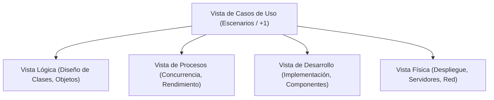
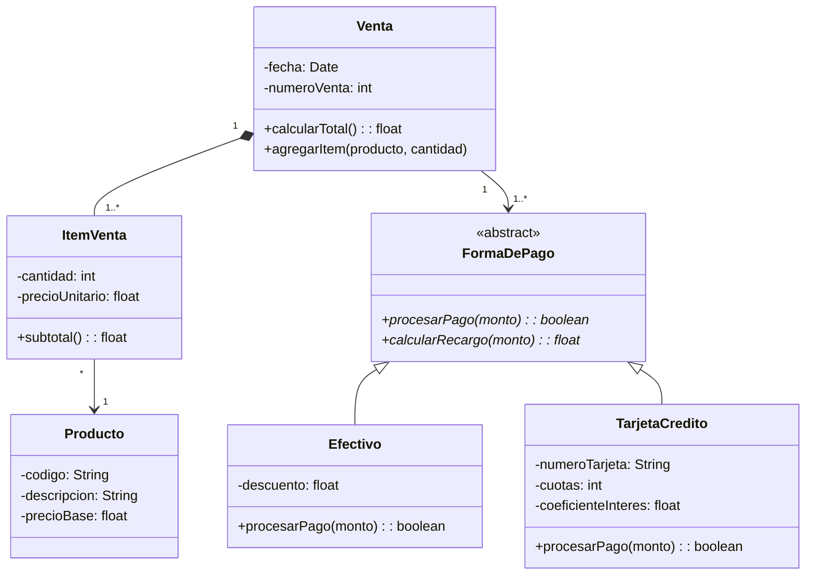
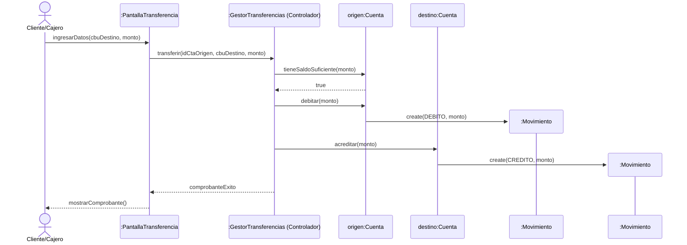
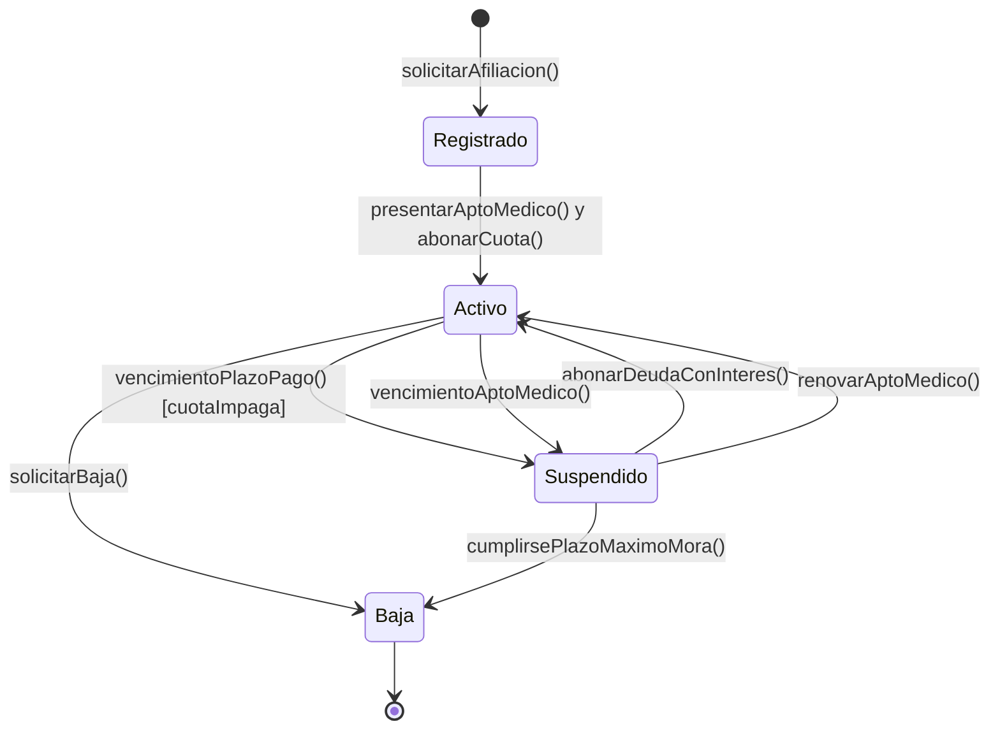
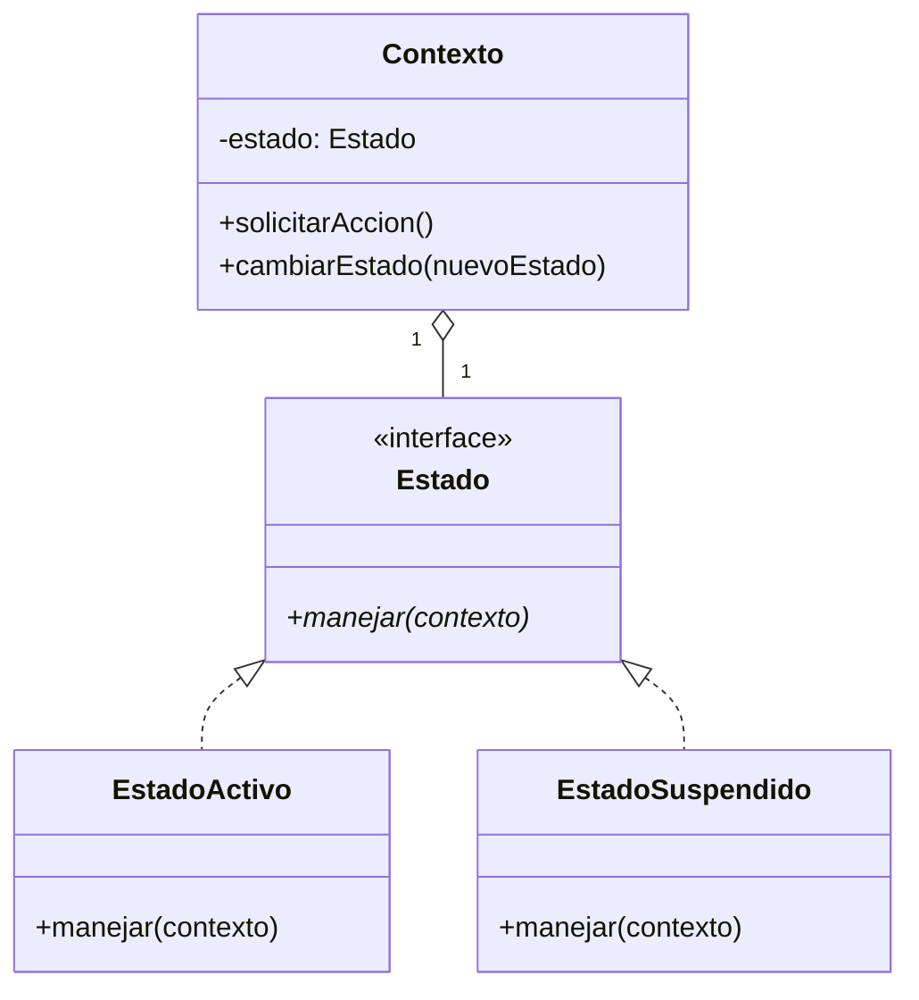
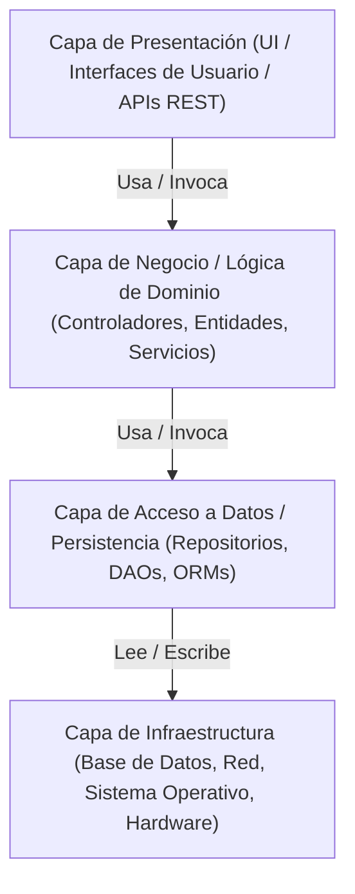

# 📚 Transcripción Integral y Compendio Temático: Diseño de Sistemas

> **Documento Maestro de Cursada y Preparación para el Examen Parcial**  
> **Materia:** Diseño de Sistemas / Ingeniería de Software  
> **Contenido:** Transcripción completa, desgloses conceptuales, análisis de patrones GRASP y GoF, diagramas UML, modelado de procesos, resolución de ejercicios y criterios de corrección de parciales.  
> **Total de grabaciones procesadas:** 14 sesiones (~28 horas de audio transcritas con marcas de tiempo).

---

## 📑 Índice General de Contenidos

- [Clase 01 (20/08/2026): Metodología RUP, Vistas 4+1 de Kruchten, UML y Casos de Uso](#clase-01-20082026-metodología-rup-vistas-41-de-kruchten-uml-y-casos-de-uso)
  - [Parte 1: Presentación, RUP, Fases, Flujos y Vistas Arquitectónicas](#clase-01---parte-1-introducción-rup-y-arquitectura)
  - [Parte 2: Especificación de Casos de Uso, Actores, Mockups y Ejercicio Gimnasio](#clase-01---parte-2-casos-de-uso-mockups-y-ejercicio-práctico)
- [Clase 02 (27/08/2026): Casos de Uso Avanzados, Requerimientos FURPS+ y Prototipado UI](#clase-02-27082026-casos-de-uso-avanzados-requerimientos-furps-y-prototipado-ui)
  - [Requerimientos Funcionales y No Funcionales (FURPS+)](#clasificación-de-requerimientos-furps)
  - [Flujos Principales, Alternativos y Excepciones](#especificación-rigurosa-de-flujos)
  - [Trazabilidad Caso de Uso ↔ Interfaz de Usuario](#trazabilidad-y-mockups)
- [Clase 03 (03/09/2026): Diagramas de Actividad, Principios POO y Diagrama de Clases de Dominio](#clase-03-03092026-diagramas-de-actividad-principios-poo-y-diagrama-de-clases-de-dominio)
  - [Parte 1: Diagramas de Actividad vs Diagramas de Secuencia](#clase-03---parte-1-diagramas-de-actividad-y-transición-al-diseño)
  - [Parte 2: Modelado Orientado a Objetos, Clases Abstractas vs Interfaces y Caso Ventas](#clase-03---parte-2-principios-poo-y-diagrama-de-clases-de-dominio)
- [Clase 05 (17/09/2026): Patrones de Asignación de Responsabilidades GRASP e Interacción](#clase-05-17092026-patrones-de-asignación-de-responsabilidades-grasp-e-interacción)
  - [Parte 1: Patrones GRASP Fundamentales (Controlador, Experto, Creador, Cohesión, Acoplamiento)](#clase-05---parte-1-patrones-grasp-y-asignación-de-responsabilidades)
  - [Parte 2: Ejercicio Integral 'Bancos Solivares' y Diagrama de Secuencia de Diseño](#clase-05---parte-2-ejercicio-integral-bancos-solivares-y-secuencia-de-diseño)
- [Clase 06 (24/09/2026): Diagramas de Transición de Estados y Secuencia Avanzada](#clase-06-24092026-diagramas-de-transición-de-estados-y-secuencia-avanzada)
  - [Parte 1: Diagramas de Estados (Eventos, Guardas, Acciones Entry/Exit/Do) y Ejercicio Aficionados](#clase-06---parte-1-diagramas-de-transición-de-estados)
  - [Parte 2: Multiobjetos, Bucles y Visibilidad en Diagramas de Secuencia](#clase-06---parte-2-secuencia-avanzada-y-visibilidad)
- [Clase 07 (01/10/2026): Patrones de Diseño GoF Creacionales y Estructurales](#clase-07-01102026-patrones-de-diseño-gof-creacionales-y-estructurales)
  - [Parte 1: Patrones Creacionales (Singleton, Factory Method, Abstract Factory, Builder, Prototype)](#clase-07---parte-1-patrones-creacionales-gof)
  - [Parte 2: Patrones Estructurales (Adapter, Bridge, Composite, Decorator, Facade, Proxy)](#clase-07---parte-2-patrones-estructurales-gof)
- [Clase 08 (08/10/2026): Patrones de Diseño GoF de Comportamiento](#clase-08-08102026-patrones-de-diseño-gof-de-comportamiento)
  - [State, Strategy y Observer](#patrones-state-strategy-y-observer)
  - [Memento, Command y Mediator](#patrones-memento-command-y-mediator)
  - [Resolución de Ejercicios Prácticos Combinados](#ejercicios-prácticos-de-patrones-de-comportamiento)
- [Clase 09 (15/10/2026): Taller Integral de Preparación para el Examen Parcial](#clase-09-15102026-taller-integral-de-preparación-para-el-examen-parcial)
  - [Estrategia de Resolución de Exámenes y Lectura de Enunciados](#estrategia-de-resolución-del-parcial)
  - [Modelos de Parcial Resueltos Paso a Paso (Diagrama de Clases + Secuencia)](#modelos-de-parcial-resueltos)
  - [Errores Críticos Comunes y Criterios de Corrección de la Cátedra](#errores-críticos-y-criterios-de-corrección)
- [Clase 11 (29/10/2026): Arquitectura de Software, Estilos Arquitectónicos, Pruebas y Despliegue](#clase-11-29102026-arquitectura-de-software-estilos-arquitectónicos-pruebas-y-despliegue)
  - [Arquitectura en Capas y Responsabilidades](#arquitectura-en-capas-layered-architecture)
  - [Estrategias de Testing (Unitarias, Integración, Beta)](#estrategias-de-testing-y-calidad)
  - [Infraestructura, IoT/Domótica y Diagrama de Despliegue](#infraestructura-iot-y-diagrama-de-despliegue)
  - [Cierre de Cursada y Lineamientos Finales](#cierre-de-cursada-y-entregas)

---

## Clase 01 (20/08/2026): Metodología RUP, Vistas 4+1 de Kruchten, UML y Casos de Uso

**Grabaciones analizadas:**  
- Parte 1: `Clase 01-20260820_082357-Grabación de la reunión.mp4` (1h 55m)  
- Parte 2: `Clase 01-20260820_102934-Grabación de la reunión.mp4` (1h 20m)  

### Ficha Resumen y Objetivos
En esta clase inaugural se presenta el marco de trabajo de la materia Diseño de Sistemas. Se establecen los fundamentos teóricos de la ingeniería de software moderna, contrastando los procesos pesados e iterativos (RUP) con metodologías ágiles (Scrum), se analiza el modelo de 4+1 vistas arquitectónicas de Kruchten, el rol del estándar UML y la técnica de especificación de requisitos mediante Casos de Uso y prototipos (mockups).

### Clase 01 - Parte 1: Introducción, RUP y Arquitectura

#### 1.1 Fundamentos de la Ingeniería de Software y el Proceso Unificado (RUP)
- **¿Qué es RUP (Rational Unified Process)?**: Es un marco de proceso de desarrollo de software iterativo e incremental, dirigido por casos de uso, centrado en la arquitectura, y enfocado en la mitigación temprana de riesgos.
- **Fases de RUP**:
  1. **Inicio (Inception)**: Se define el alcance del proyecto, la viabilidad económica y técnica, se identifican los actores y casos de uso principales, y se mitigan los riesgos iniciales.
  2. **Elaboración (Elaboration)**: Se define la arquitectura base ejecutable (baseline arquitectónica), se detallan la mayoría de los casos de uso (~80%), y se mitigan los riesgos arquitectónicos críticos.
  3. **Construcción (Construction)**: Desarrollo masivo del sistema, codificación de componentes, pruebas unitarias y de integración.
  4. **Transición (Transition)**: Despliegue del producto en el entorno del usuario, pruebas beta, capacitación y ajustes finales.

#### 1.2 El Modelo de 4+1 Vistas de Philippe Kruchten
El profesor explica que para describir una arquitectura de software compleja no alcanza con un único diagrama, sino que se requiere segregar responsabilidades según los intereses de los distintos involucrados (stakeholders):

- **Vista Lógica**: Enfocada en los requisitos funcionales. Se modela mediante Diagramas de Clases, Diagramas de Objetos y Diagramas de Interacción.
- **Vista de Procesos**: Enfocada en requerimientos no funcionales de rendimiento, escalabilidad, concurrencia y sincronización. Se modela mediante hilos, procesos y Diagramas de Actividad.
- **Vista de Desarrollo (Implementación)**: Enfocada en la organización del código fuente, módulos, paquetes, bibliotecas y subsistemas. Modelada con Diagramas de Componentes y Paquetes.
- **Vista Física (Despliegue)**: Enfocada en la topología de hardware, nodos, servidores y conexiones de red. Modelada con Diagramas de Despliegue.
- **Vista de Casos de Uso (+1)**: Es el corazón que une y valida todas las demás vistas. Representa los escenarios que el sistema debe satisfacer.

### Clase 01 - Parte 2: Casos de Uso, Mockups y Ejercicio Práctico

#### 1.3 Especificación Rigurosa de Casos de Uso
- **Actor**: Entidad externa que interactúa con el sistema (puede ser un usuario humano, otro sistema externo o el reloj/tiempo para tareas automáticas).
- **Límite del Sistema (System Boundary)**: Delimita lo que está dentro de la responsabilidad del software y lo que es externo.
- **Relaciones entre Casos de Uso**:
  - `<<include>>`: Inclusión obligatoria. El caso de uso base no puede completarse sin ejecutar el caso de uso incluido (ejemplo: 'Emitir Factura' incluye 'Calcular Impuestos').
  - `<<extend>>`: Extensión condicional u opcional. Se ejecuta solo bajo ciertas condiciones en un punto de extensión específico (ejemplo: 'Cobrar Cuota' extendido por 'Aplicar Recargo por Mora').
  - **Generalización**: Relación de herencia entre casos de uso o entre actores (ejemplo: Actor 'Administrador' hereda de 'Usuario Autenticado').

#### 1.4 Ejercicio Práctico de Clase: Gestión de Reservas de Gimnasio
- **Problema planteado**: Un gimnasio tiene clases puntuales (como yoga o spinning) donde hay cupos limitados. Se generan problemas porque a veces no va nadie y otras veces hay sobrecupo y los socios no tienen lugar para colocar la colchoneta.
- **Solución requerida**:
  - Caso de Uso: **Reservar Turno de Clase Puntual**.
  - **Flujo Principal**:
    1. El socio ingresa al sistema con sus credenciales.
    2. El sistema valida el estado de la cuota del socio (debe estar al día).
    3. El socio consulta el cronograma de clases disponibles para la fecha.
    4. El sistema presenta las clases, instructores y cupos disponibles en tiempo real.
    5. El socio selecciona la clase deseada y confirma la reserva.
    6. El sistema decrementa el cupo disponible y emite el comprobante de reserva digital.
  - **Flujos Alternativos / Excepciones**:
    - 2a. Cuota vencida: El sistema notifica la imposibilidad de reservar y redirige a la pasarela de pagos.
    - 5a. Sin cupo disponible: El sistema ofrece anotarse en lista de espera.
- **Mockups de Interfaz**: Se explicó la importancia de construir mockups (pantallas simples con formularios, tablas y botones de confirmación) para validar con el usuario los campos de datos requeridos antes de pasar al diseño de clases.

#### 1.5 Registro Cronológico de la Clase 01 (Extracto de Audio)

- `[00:00:02 - 00:00:28]` Me acordé un poco tarde, pero bueno, ¿me imagina? Sí, sí. ¿Sas tan grabando? Sí, pero fe. Fantástico, guarda, muchas gracias. Bueno, como les decía,
- `[00:02:06 - 00:02:11]` que el día de mañana cuando trabajen, hoy mismo los que están trabajando, que digan,
- `[00:04:09 - 00:04:17]` puedo entender como es la separación del derecho de estas varias cosas, entonces leyes ustedes
- `[00:06:15 - 00:06:24]` tenemos un canal que es 26 segundo cubo, segundo cuatro y maestres, en este canal yo pongo todo lo
- `[00:08:21 - 00:08:28]` que son realmente necesarios para la curzada, esto no significa que lo tienen que leer todos,
- `[00:10:32 - 00:10:49]` vamos a ver, vamos a dar algunas herramientas, yo uso mucho el visual estudio code a veces,
- `[00:12:39 - 00:12:48]` empezar a armar un poquito ese ambiente, también a lo que uso mucho, ustedes pueden utilizar
- `[00:14:50 - 00:15:02]` la conexión y este vuelo bastante tedioso, entonces lo uso bastante, acá hay ejercicios modelos,
- `[00:16:57 - 00:17:09]` uno se ejercicio para ir trabajando en clase, esto es bibliografía, ya estaría,
- `[00:19:08 - 00:19:19]` sí, para mí es fácil, estoy ahí, tiene mucho contenido en la materia y tiene un contenido que se va
- `[00:21:10 - 00:21:18]` entonces viene la del examen y es el primer día que se sienten analizar una especificación y
- `[00:23:20 - 00:23:26]` bueno, nadie quise hablar, hay algunos recursos antes que lo que eran cuatro, a ver cómo voy a fijar
- `[00:25:24 - 00:25:33]` estén tentativo, por suerte no hay feriados, la comisión de los jueves, los lunes tiene cuatro
- `[00:27:27 - 00:27:37]` si ofertó, si, si ofertó en verano, para alumnos recursos antes, es decir, ya han dado los
- `[00:29:30 - 00:29:38]` 6, o sea, se anotaron, pagaron, porque creo que en el verano se paga, ¿no? Sí, se paga,
- `[00:00:56 - 00:01:09]` Bueno, buenas y traientas tan. Estamos profesando. Están, están, no se fueron. Todos méritos de eso.
- `[00:03:06 - 00:03:20]` en software. Entonces, una metodología ágil no va a servir porque necesitamos tener un rastreo muy fuerte. Eso es por un tema de, ya cuando estemos
- `[00:05:43 - 00:05:57]` Así vamos a la parte tráctica, vamos a abrir, ¿qué batería? Creo que en sistemas de información.
- `[00:08:02 - 00:08:26]` para usar una palabra pero es lo mismo, para poder justamente armar un proceso un poco más ágil para el desarrollo del software, y se va a saludar a algunos principios, obviamente hay cuatro que son los fundamentales, que son los individuos y interacciones ante los procesos de extución y la herramienta,
- `[00:10:05 - 00:10:13]` Qué te piensan? Muy bien. Cambam también, ¿qué es eso? Cambam, me encanta, se está más
- `[00:12:08 - 00:12:14]` y armar, no, proyectos, pero lo interesante es que son ciclos cortos de trabajo, para estos
- `[00:14:13 - 00:14:21]` proyectos pero facilita el proceso, trata de eliminar los riesgos, que pueden frenar
- `[00:16:20 - 00:16:26]` la Planificación, que es la reunión inicial para definir qué va a ser, es Spring,
- `[00:18:26 - 00:18:32]` si vamos, bueno, yo voy a tener, quiero que tengo el Product Baglog, voy a tener acá tarjetas
- `[00:20:30 - 00:20:44]` comenzar y definir los sprint backlog, ok, bueno, DailyMitting es muy sencillo, cada 15 minutos,
- `[00:22:31 - 00:22:40]` que son como una especie de criterias de testing, a medida que se va interando se puede ir a agregar
- `[00:24:39 - 00:24:44]` puedo llegar a tener con Rube que me dice el paso a paso como armar una retextura y qué cual es
- `[00:26:39 - 00:26:56]` vengo acá, esto que le hace acordar, me dijeron en una metodología, acá podría yo aplicar,
- `[00:28:52 - 00:29:08]` vengo para acá, ustedes van a jugar acá en esta área, despido disculpas, a los que están
- `[00:31:00 - 00:31:09]` hoy ustedes son todos desarrolladores que ya manejan Scram y ya manejan trajetas de usuario,

---

## Clase 02 (27/08/2026): Casos de Uso Avanzados, Requerimientos FURPS+ y Prototipado UI

**Grabación analizada:** `Teams meeting-20260827_081937-Grabación de la reunión.mp4` (3h 07m)

### Ficha Resumen y Objetivos
Esta clase profundiza en la elicitación y especificación formal de requerimientos de software. Se estudia el modelo de clasificación FURPS+, la redacción detallada de casos de uso (precondiciones, postcondiciones, flujos alternativos y manejo de excepciones), y la trazabilidad directa entre las especificaciones textuales y la navegación en prototipos de interfaz de usuario.

### Clasificación de Requerimientos: Modelo FURPS+
El modelo propuesto por Hewlett-Packard y adoptado por RUP categoriza los requisitos en cinco dimensiones clave:
1. **F (Functionality - Funcionalidad)**: Capacidades del sistema, características comerciales, seguridad, reglas de cálculo, casos de uso.
2. **U (Usability - Usabilidad)**: Facilidad de aprendizaje, ergonomía visual, accesibilidad, estándares de interfaz, prevención y recuperación ante errores humanos.
3. **R (Reliability - Confiabilidad)**: Frecuencia y gravedad de fallas, tiempo medio entre fallas (MTBF), capacidad de recuperación ante desastres (MTTR), precisión de resultados.
4. **P (Performance - Rendimiento)**: Tiempos de respuesta (ej. 'las transacciones deben responder en menos de 2 segundos'), concurrencia de usuarios simultáneos, throughput, consumo de memoria y CPU.
5. **S (Supportability - Soportabilidad)**: Mantenibilidad del código, extensibilidad, modularidad, facilidad de prueba (testability), configurabilidad, compatibilidad de plataformas.
- **El signo '+'**: Incluye restricciones de diseño (ej. uso obligatorio de lenguaje Java o motor PostgreSQL), requerimientos de implementación, de interfaz física y empaquetamiento.

### Especificación Rigurosa de Flujos
- **Precondiciones**: Estado en el que DEBE encontrarse el sistema antes de que el caso de uso pueda comenzar (ej. 'El usuario debe haber iniciado sesión con rol Administrador').
- **Postcondiciones (Garantía de Éxito)**: Estado en el que queda el sistema tras la ejecución exitosa del caso de uso (ej. 'Se crea el registro de venta con estado PENDIENTE_ENTREGA y se reduce el stock disponible').
- **Postcondiciones Mínimas (Garantía de Falla)**: Qué garantiza el sistema si el caso de uso es abortado (ej. 'No se descuenta dinero de la cuenta del cliente ni se modifica el inventario').

### Trazabilidad y Mockups
Se corrigieron los trabajos presentados por los alumnos en planillas compartidas. El profesor remarcó:
> *'Cada botón, campo de entrada o mensaje de error en una pantalla debe tener su justificación directa en un paso del flujo del Caso de Uso. Si en la pantalla hay un campo que no está en el caso de uso, falta especificarlo; y si el caso de uso pide un dato que no está en la pantalla, la interfaz está incompleta.'*

#### Registro Cronológico de la Clase 02 (Extracto de Audio)

- `[00:00:02 - 00:00:49]` Recuerdan la clase pasada, nosotros, andiéndole de metintadora. Sí, se ve profundo. Recuerdan la clase pasada,
- `[00:02:08 - 00:02:14]` Esta la idea es que esta semana la poda cerrar ya que vamos conformados con los grupos.
- `[00:04:18 - 00:04:23]` Cuando estoy armando, está cuando me estoy acercando al código.
- `[00:06:35 - 00:06:42]` Seguro empezar a armar todas las historias de usuarios.
- `[00:08:35 - 00:08:45]` están aquí y no nos entienden en el negocio y vamos a tratar de priorizarlo, junto con el cliente.
- `[00:10:40 - 00:10:48]` Por lo tanto, lo que sabemos de User Experience es que es el proceso para poder diseñar unos productos.
- `[00:12:44 - 00:12:49]` pero es la investigación, comprender las necesidades del usuario.
- `[00:14:50 - 00:15:04]` Por lo tanto, lo que nosotros vamos a querer evaluar es armar un producto que por lo menos sea amigable con el usuario y ver cómo es este proceso de Wiki para llevarlo a cabo.
- `[00:16:57 - 00:17:13]` Ahora vamos a estar enfocados en esta parte. ¿Cuáles son los elementos fundamentales de Wiki? Primero crear Mi User Person.
- `[00:19:11 - 00:19:21]` el tipo de edad que tienen, cómo es su día a día, en qué lo puede ayudar esta solución.
- `[00:21:23 - 00:21:33]` y te hagamos una aplicación que logren entender también, cuáles son las necesidades del usuario, que no son a veces las mismas necesidades que las de él, ¿ok?
- `[00:23:27 - 00:23:38]` bueno lo que yo puedo lograr hacer es utilizar los gitmaps, donde el rojo representa las zonas donde más click hacen,
- `[00:25:32 - 00:25:40]` logramos hacer las historias del usuario, obviamente esas historias del usuario necesitan ser ordenadas,
- `[00:27:39 - 00:27:48]` tome algunas de ustedes, algunas las las cambien, les agreguen, les sacote,
- `[00:29:49 - 00:30:00]` ahora bien, como yo hice una operación o una categorización por usuario,
- `[00:31:59 - 00:32:07]` tiene que armar las rutinas a los clientes, sea sus alumnos, acá me falta una n, importa,
- `[00:34:05 - 00:34:12]` una vez que hice eso, categoricé es fundamental categorizar antes de diseñar la navegación como quiero que lo hagas,
- `[00:36:07 - 00:36:12]` que tengan todas las cuotas al día,
- `[00:38:12 - 00:38:19]` entonces lo que vamos a hacer es un representante por grupo,
- `[00:43:28 - 00:43:35]` la paz que yo sé que a veces no es la clase tradicional, ordenada,
- `[00:45:38 - 00:45:45]` Si yo comiendo por donde hay más sor dolencia, tengo la posibilidad de poder,
- `[00:47:43 - 00:47:47]` Vamos acá hasta el de Miranda, ¿OK?
- `[00:49:47 - 00:49:52]` El usuario de esta manera, como es de navegación,
- `[00:51:52 - 00:51:57]` Volvo a categorizar, y ahí empiezo a identificar las posibles pantasas
- `[00:53:59 - 00:54:06]` Acá estoy haciendo una vista de lo que voy a querer hacer.

---

## Clase 03 (03/09/2026): Diagramas de Actividad, Principios POO y Diagrama de Clases de Dominio

**Grabaciones analizadas:**  
- Parte 1: `Clase 03-20260903_081406-Grabación de la reunión 1.mp4` (1h 43m)  
- Parte 2: `Clase 03-20260903_101348-Grabación de la reunión.mp4` (1h 29m)  

### Ficha Resumen y Objetivos
En esta clase se produce el paso crítico desde el análisis de requerimientos hacia el modelado de diseño. Se revisan los Diagramas de Actividad para modelar flujos de trabajo paralelos y de negocio, y se construyen las bases del Diagrama de Clases del Dominio aplicando conceptos clave de Programación Orientada a Objetos: clases abstractas, interfaces, herencia versus composición, asociaciones y multiplicidades.

### Clase 03 - Parte 1: Diagramas de Actividad y Transición al Diseño

#### 3.1 Diagramas de Actividad en UML
- **Propósito**: Modelar el flujo de control y de datos entre actividades de negocio o de software. Son el equivalente en UML a diagramas de flujo avanzados con soporte de concurrencia.
- **Elementos Fundamentales**:
  - **Nodo Inicial y Nodo Final** (círculo sólido y círculo con borde).
  - **Acciones / Actividades** (rectángulos con esquinas redondeadas).
  - **Bifurcaciones de Decisión y Fusión (Decision & Merge)**: Rombos con condiciones de guarda mutuamente excluyentes `[condición]`.
  - **Sincronización (Fork & Join)**: Barras horizontales o verticales gruesas para representar inicio de actividades paralelas (fork) y espera de todas las ramas concurrentes para continuar (join).
  - **Particiones / Carriles (Swimlanes)**: Columnas que asignan responsabilidades organizacionales o de capas del sistema (ej. Cliente, Sistema de Ventas, Pasarela de Pagos).

### Clase 03 - Parte 2: Principios POO y Diagrama de Clases de Dominio

#### 3.2 Principios de Diseño Orientado a Objetos
- **Clases Abstractas vs Interfaces**:
  - **Clase Abstracta**: Modela una relación jerárquica 'ES UN' (`is-a`). Puede contener atributos de estado y métodos con implementación concreta compartida por todas las subclases, además de métodos abstractos obligatorios.
  - **Interface**: Define un contrato puro de comportamiento ('PUEDE COMPORTARSE COMO' / `can-do`). No posee estado interno de instancia. Permite polimorfismo entre clases que no pertenecen a la misma jerarquía de herencia.
- **Herencia vs Composición**:
  - Regla de oro enseñada en la cátedra: *'Favorecer siempre la composición sobre la herencia'*. La herencia estática genera un acoplamiento muy fuerte en tiempo de compilación. La composición mediante interfaces permite variar el comportamiento dinámicamente en tiempo de ejecución.

#### 3.3 Caso Práctico Modelado: Sistema de Ventas y Formas de Pago
- **Problema**: Modelar una venta donde el cliente puede abonar con diversas formas de pago (Efectivo, Tarjeta de Crédito en cuotas, Transferencia Bancaria), y donde aplican diferentes promociones y recargos.
- **Solución de Diseño**:

#### Registro Cronológico de la Clase 03 (Extracto de Audio)

- `[00:00:15 - 00:02:11]` Hola. Hola, ¿cómo andan? Buen día. Buen día, nunca. Buen día. Buen día. Buen día, ¿cómo andan? Ahora sí, ¿cómo están todos acá? Buen apropio. No, poquito soy. No conseguí aula para el día de hoy. Así que, tuvimos que hacer la reunión virtual por eso mandé la invitación. La clase que viene sí, tengo aula. Ahora se las voy a pasar. Así ya les queda.
- `[00:03:54 - 00:04:38]` Se debemos hacer la clase de hoy, un repaso sobre todos los diagramas, vamos a hacer por parte un minuto. Vamos a compartir.
- `[00:06:06 - 00:06:24]` Recuerdan que vivimos esto, tuvimos hablando sobre la ingeniería de software, nuestro focus siempre en lo que ingeniería y dependiente de las ingenierías, es construir un producto con calidad y obviamente nos bajamos en algunos procesos.
- `[00:08:10 - 00:08:33]` La idea es que siempre vamos mezclando usando diferentes metodologías, las metodologías puras, puras, es muy difícil de utilizar uno, va conociendo diferentes procesos y va utilizando esos procesos las buenas prácticas de los mismos.
- `[00:10:16 - 00:10:26]` Yo suelo empezar a relacionar un poco los temas y tratar de darle un contexto con respecto al diseño, ¿ok?
- `[00:12:35 - 00:12:58]` ella es un poco más elaborado, se define una secuencia entre el actor y el sistema, hay una instancia, pero de una mira una instancia del caso de uso, es una historia particular y donde si yo voy a ir con todas las disfruccaciones del historio de usuario, ya habéis de hablar de algunos, de incluir algunos externos.
- `[00:14:36 - 00:14:45]` Son requisitos, significa que es lo que va a hacer el sistema, basándonos justamente en escenario, interacción entre el actor y el sistema.
- `[00:16:57 - 00:17:13]` Bueno, entonces si me voy a la especificación del caso de uso, lo que yo estoy describiendo, tengo diferentes tipos de elementos, obviamente ustedes me comentaron este actor, fundamental en el actor.
- `[00:18:59 - 00:19:06]` Principal es porque tienen lo objetivo primordial, el mayor beneficio de todo esto.
- `[00:21:02 - 00:21:07]` Otro de los elementos fundamentales que tienen es el nombre, es fundamental que sea el nombre.
- `[00:23:14 - 00:23:25]` Después está la segunda forma, donde ya no tengo una columna, tengo ya dos columnas, en donde separo las acciones del actor con las acciones del sistema.
- `[00:25:17 - 00:25:28]` Arrasten otros elementos, pos condiciones, uso alternativo, si estoy trabajando en las formas dos, los flujes alternativos también, respeto estas dos columnas.
- `[00:27:27 - 00:27:32]` se recuerdan que en el ejercicio del gimnasio estuvimos también trabajando, esto lo voy a programar, ¿no?
- `[00:29:29 - 00:29:45]` Si yo la realidad es que todo lo demás es bastante sencillo, pero quiero saber quienes son los que están activos,
- `[00:31:30 - 00:31:34]` Ahora si tengo algo muy complejo, me voy a interactuar con otros sistemas,
- `[00:02:11 - 00:02:30]` Bueno, estamos. Bueno, se pasa rápido en la hora del recreo, ¿eh? Hasta. Una arranquemos.
- `[00:04:21 - 00:04:32]` es poner entre parantes y sangulares la palabra abstracta. Había uno, un alumno que me había dicho como era,
- `[00:06:40 - 00:06:47]` Nada, ningún método que sea desarrollado en un acoendo, ¿ok?
- `[00:08:59 - 00:09:17]` esto lo voy a dir, y solamente tengo declaraciones, porque cada uno tiene un comportamiento tan diferente, si los métodos los voy a desarrollar en cada uno de estos,
- `[00:11:11 - 00:11:35]` frases nominales vienen, vienen de un concepto de lengua y literatura donde habla que las frases nominal, donde los más importantes de una oración es en sustantivo, por lo tanto lo que nos recomienda justamente el arma es empezar a detectar frases nominales, ¿ok?
- `[00:13:38 - 00:14:11]` Estamos en la duda, entonces con verde voy a marcar los adelutos, posibles adributos, obviamente siempre candidatos, civiles adributos que sean candidatos, y a lo que es fundamental y están en los principios del buen diseño, que sea completo, no la pusiera cálode a por la casa,
- `[00:16:08 - 00:16:28]` Si están en un momento del exámen, donde yo se concejo, donde no saben por dónde están, o están mareados, organizanse, empiezan a hacer cosas básicas, vuelvan al inicio, empiezan a analizar, yo les voy a dar los casos de uso pero si lo veo una especificación bastante amplia,
- `[00:18:20 - 00:18:49]` pasen al diagrama de clase, luego lo voy a remarcar, ponen ingresar pago, muy bien, el sistema muestre el estado, monta lo que es el atributo, vamos a poner al atributo, y el estado de la cuenta de en el paso, vamos a ponerlo, con tu conocimiento,
- `[00:20:27 - 00:20:38]` lo que pasa que son diferentes comportamientos, uno es para definir lo que es la categoría de qué es lo que quiero pagar,
- `[00:22:33 - 00:22:44]` ahora no va a estar escribiendo cómo hacer la mezcla de cemento, estoy lleno un poco exagerado pero no importa, ¿cómo va a ser la mezcla del cemento?
- `[00:24:48 - 00:24:55]` un poco de la serie como para dar algo de la serie, no voy a hacer nada pero en lo que sí yo puedo hacer una funcionalidad,
- `[00:27:00 - 00:27:14]` bueno vamos a macarlo, además, acá me te describe la evaluación separada de la importancia,
- `[00:29:07 - 00:29:09]` es decir, me confundir con un alumno.
- `[00:31:17 - 00:31:19]` En un cáncate minuto, Cérico.
- `[00:33:24 - 00:33:27]` Hay varias opciones de pago, opciones esta.

---

## Clase 05 (17/09/2026): Patrones de Asignación de Responsabilidades GRASP e Interacción

**Grabaciones analizadas:**  
- Parte 1: `Clase 05-20260917_081823-Meeting Recording.mp4` (1h 45m)  
- Parte 2: `Clase 05-20260917_101702-Grabación de la reunión.mp4` (1h 34m)  

### Ficha Resumen y Objetivos
Clase fundamental de la materia. Se enseñan los patrones GRASP (General Responsibility Assignment Software Patterns) propuestos por Craig Larman. Estos principios guían la toma de decisiones al responder la pregunta clave del diseño orientado a objetos: *¿A qué clase le asigno cada método y responsabilidad?* Se integran los patrones con el diseño de Diagramas de Secuencia mediante el caso práctico 'Bancos Solivares'.

### Clase 05 - Parte 1: Patrones GRASP y Asignación de Responsabilidades

#### 5.1 Los 9 Patrones GRASP Fundamentales
1. **Controlador (Controller)**:
   - **Problema**: ¿Cuál es el primer objeto que recibe los eventos del sistema procedentes de la capa de interfaz de usuario?
   - **Solución**: Un objeto que representa al sistema global (Controlador de Fachada / Façade Controller) o que representa el escenario de caso de uso en curso (Controlador de Caso de Uso / Handler).
   - **Regla de oro**: El controlador NUNCA debe ejecutar la lógica de negocio; su rol es coordinar y delegar inmediatamente a los objetos del dominio.
2. **Experto en Información (Information Expert)**:
   - **Problema**: ¿Cuál es el principio general para asignar responsabilidades a los objetos?
   - **Solución**: Asignar la responsabilidad a la clase que posee la información necesaria para cumplirla. Si `ItemVenta` tiene la `cantidad` y conoce a `Producto` (que tiene el `precio`), `ItemVenta` es el experto para calcular el `subtotal()`.
3. **Creador (Creator)**:
   - **Problema**: ¿Quién debe ser responsable de crear una nueva instancia de una clase `A`?
   - **Solución**: Asignar la creación a la clase `B` si `B` contiene o agrega a `A`, `B` registra a `A`, `B` usa cercanamente a `A`, o `B` tiene los datos de inicialización de `A`. (Ejemplo: `Venta` crea sus propios `ItemVenta`).
4. **Alta Cohesión (High Cohesion)**:
   - Las responsabilidades de una clase deben estar estrechamente relacionadas entre sí y no debe abarcar tareas dispares. Una clase con alta cohesión es fácil de mantener, reutilizar y comprender.
5. **Bajo Acoplamiento (Low Coupling)**:
   - Minimizar la interdependencia entre clases para que los cambios en una no impacten en cascada sobre las demás.
6. **Fabricación Pura (Pure Fabrication)**:
   - Cuando asignar una responsabilidad a un concepto del dominio rompe la alta cohesión o el bajo acoplamiento, se inventa una clase artificial que no existe en el dominio del negocio (ej. `GestorDePagos`, `RepositorioClientes`, `FabricaProductos`).
7. **Indirección (Indirection)**:
   - Asignar una responsabilidad a un objeto intermediario para evitar el acoplamiento directo entre dos componentes.
8. **Polimorfismo (Polymorphism)**:
   - Asignar el comportamiento que varía según el tipo a operaciones polimórficas mediante interfaces o clases abstractas, en lugar de usar sentencias `switch` o `if/else` basados en tipos.
9. **Variaciones Protegidas (Protected Variations)**:
   - Identificar los puntos de inestabilidad o cambio probable y crear interfaces estables alrededor de ellos.

### Clase 05 - Parte 2: Ejercicio Integral 'Bancos Solivares' y Secuencia de Diseño

#### 5.2 Análisis del Caso 'Bancos Solivares'
- **Enunciado**: El banco maneja cuentas de clientes (caja de ahorro, cuenta corriente) con distintas comisiones e intereses. Se requiere registrar depósitos y transferencias bancarias entre cuentas garantizando consistencia, validación de saldos y emisión de comprobantes.
- **Decisiones de Diseño Discutidas en Clase**:
  - Se introduce un `GestorTransferencias` (Fabricación Pura / Controlador) para no acoplar la UI a las entidades `Cuenta` ni poner lógica de transferencias dentro de una cuenta particular.
  - La verificación de fondos disponibles se delega a la `Cuenta` origen (Experto en Información).
  - La creación del `Movimiento` o `Transaccion` la realiza la `Cuenta` afectada (Creador).

#### 5.3 Diagrama de Secuencia del Caso de Uso 'Realizar Transferencia'

#### Registro Cronológico de la Clase 05 (Extracto de Audio)

- `[00:00:03 - 00:00:42]` Vamos a compartir mi computadora. Sí se ve, tres de los grasa. Fantástico. Bueno, la idea es poder hacer un ejercicio. Vamos a hacer el ejercicio de bancos solivares, yo lo voy a leer muy rápidamente, voy a poner en foco algunas cosas y la idea es ir armando una solución.
- `[00:02:11 - 00:02:22]` Tenemos personas, ejecutivo, clientes, su cruzal de origen, caja de ahorro, cuantas corrientes, préstamos, cuantas evaluaciones, bien propiedades, seguro y préstamo en protecario.
- `[00:04:12 - 00:04:15]` Por el diagrama de clases, muy bien, ¿Otra?
- `[00:06:13 - 00:06:15]` Explique el diagrama de explíde gente.
- `[00:08:14 - 00:08:19]` es una caja entre dimensiones, que yo puedo colocar,
- `[00:10:26 - 00:10:37]` Y voy a separar, no tengo muchos elementos en VML para este tipo de diagrama,
- `[00:12:33 - 00:12:35]` O por lo menos que pueda tener.
- `[00:14:34 - 00:14:37]` yo trabajo con algunos productos de IBM,
- `[00:16:35 - 00:16:38]` Entonces yo voy a empezar con los clientes.
- `[00:18:39 - 00:18:43]` todo lo que es, la verdad que es bastante intuitiva
- `[00:20:47 - 00:20:54]` pues yo voy a dar varias sucurzales y esta estructura de ver que me has resplicada, pero voy a considerar
- `[00:22:57 - 00:23:17]` un a yo separarlos ambientes, digo bueno voy a tratar de separar los ambientes en los cuales
- `[00:24:58 - 00:25:05]` en la parte donde dice texto, abajo de donde no, en texto hay en el medio, hay una que está
- `[00:27:11 - 00:28:01]` para que, voy a colocar de descentral, un minutito, y piso separar ambientes, ahora después
- `[00:29:20 - 00:29:41]` en sí yo la realidad que, si sé que trabajo con un sistema externo, eso es bastante de
- `[00:00:01 - 00:00:20]` El libro es la grabación a los chicos, los alumnos de los lunes que tengo cuatro feriados, no sé cómo. Ahí ya le inicié, profe. Muchísimas gracias, yo para... estoy compartiendo si no.
- `[00:02:08 - 00:02:12]` veo si después lo modifico, pero por lo menos esto me da una idea de cómo lo voy a empezar a
- `[00:04:15 - 00:04:23]` si tengo que mandar algunas imágenes de otros, también y después el browser y la capacidad
- `[00:06:15 - 00:06:24]` una capa donde voy a tener todos los controladores, recuerda en qué larmas dice un controlador o un
- `[00:08:16 - 00:08:26]` el, me voy a ponerlo acá, más que ir a préstamo debería ir a servicios o a productos,
- `[00:10:17 - 00:10:32]` caja de ahorro, perdón, el cuenta, caja de ahorro, también el préstamo, la especificación del préstamo
- `[00:12:18 - 00:12:34]` nivel de entendimiento, así que suma, ok, un producto puede ser también este, un producto, pues una cuenta,
- `[00:14:26 - 00:14:38]` donde digo crear carpeta, carpeta préstamo, este es una HTML, vamos a algo concreto HTML,
- `[00:16:28 - 00:16:36]` recibes de cliente, esperame, está, lo escaneo y lo subo, lo asocio algo, después vemos,
- `[00:18:39 - 00:18:45]` claro, porque estás asociándolo y acuerdo a la naturaleza en común, la más cercana
- `[00:20:43 - 00:20:53]` es el que lo hace, eso es un tema de análisis, ya entendí, el día de mañana, imagínense que
- `[00:22:46 - 00:22:55]` debería capturar, con ella con el préstamo, o sea, por lo que tenemos ahora, debería encontrar
- `[00:24:57 - 00:25:12]` por lo que yo evalué, tiene el historio de créditicio, y si o algo que me piden cuando voy
- `[00:27:10 - 00:27:24]` evaluó, tenemos los clientes que tienen productos adquiridos de que tipo, y todos los productos del
- `[00:29:12 - 00:29:22]` Controlador de clientes, vamos a poner un controlador de clientes, ahora cuando el cliente

---

## Clase 06 (24/09/2026): Diagramas de Transición de Estados y Secuencia Avanzada

**Grabaciones analizadas:**  
- Parte 1: `Clase 06-20260924_082126-Grabación de la reunión.mp4` (2h 21m)  
- Parte 2: `Clase 06-20260924_114136-Grabación de la reunión.mp4` (20m)  

### Ficha Resumen y Objetivos
Se profundiza en el modelado dinámico del software. La primera parte se enfoca en los Diagramas de Transición de Estados (State Machine Diagrams), su sintaxis formal (eventos, guardas, acciones internas entry/exit/do) y cuándo justifican su uso. La segunda parte aborda aspectos avanzados de Diagramas de Secuencia: multiobjetos, iteraciones sobre colecciones y notación de visibilidad de métodos y atributos.

### Clase 06 - Parte 1: Diagramas de Transición de Estados

#### 6.1 Anatomía de una Máquina de Estados en UML
- **Estado**: Condición o situación en la vida de un objeto durante la cual satisface alguna condición, realiza alguna actividad o espera algún evento.
- **Transición**: Relación entre dos estados que indica que un objeto en el primer estado ejecutará ciertas acciones y entrará en el segundo estado cuando ocurra un evento especificado y se satisfagan las condiciones de guarda.
- **Sintaxis de la Transición**:  
  `evento (parámetros) [guardia] / acción_efecto`
- **Acciones Internas del Estado**:
  - `entry / acción`: Se ejecuta inmediatamente al ingresar al estado.
  - `exit / acción`: Se ejecuta inmediatamente antes de abandonar el estado.
  - `do / actividad`: Tarea continua que se ejecuta mientras el objeto permanece en el estado (puede ser interrumpida por un evento).

#### 6.2 Ejercicio Práctico: Ciclo de Vida del 'Aficionado / Socio de Club'
- **Estados identificados**:
  1. `Registrado`: Alta inicial pendiente de validación médica o pago inicial.
  2. `Activo / Habilitado`: Cuota al día y apto médico vigente. Puede ingresar a las instalaciones y reservar turnos.
  3. `Suspendido / Con Deuda`: Venció el plazo de pago. El acceso físico queda bloqueado temporalmente hasta regularización.
  4. `Inactivo / Baja`: El socio solicita la baja voluntaria o se da de baja por inactividad prolongada.

### Clase 06 - Parte 2: Secuencia Avanzada y Visibilidad

#### 6.3 Notaciones Avanzadas en Diagramas de Secuencia
- **Multiobjetos y Colecciones**: Cuando un objeto interactúa con una lista o colección de objetos (ejemplo: un `Pedido` que recorre su lista de `ItemPedido`), se representa con el símbolo de doble rectángulo o línea de vida designada como `:List<ItemPedido>`.
- **Fragmentos Combinados (Interaction Frames)**:
  - `loop [condición]`: Itera sobre elementos de una colección.
  - `alt [condición 1] / [else]`: Ramificación condicional excluyente.
  - `opt [condición]`: Bloque opcional que se ejecuta solo si la guarda es verdadera.
- **Convenciones de Visibilidad**:
  - `+` Público (accesible por cualquier clase).
  - `-` Privado (accesible únicamente por la propia clase).
  - `#` Protegido (accesible por la clase y sus subclases).
  - `~` Paquete (accesible por clases del mismo paquete).

#### Registro Cronológico de la Clase 06 (Extracto de Audio)

- `[00:00:07 - 00:00:47]` Están grabando. Y profe. Tontásticos. Estilla. No me voy a subir acá en el chat. Para no tener tantas cosas, porque está en el documento, en el work que yo subí, dice guía de ejercicios para clases estudiantes. Es el ejercicio de casos de estados. La idea de ejercicios, yo las voy a empezar a arrancar,
- `[00:11:04 - 00:11:10]` Fue, cuando dice que se puede comprar la entrada en cajeros y otros canales de comerse de craco.
- `[00:13:15 - 00:13:26]` Las huella personales y la huella y las huechas de actiladas.
- `[00:15:26 - 00:15:34]` Es por eso que arranqué, no para acá, y voy a arrancar con algunos diagramas.
- `[00:17:42 - 00:18:01]` de esta manera de desaparecer el expendio de entradas en las boliterías, una instancia que interáversas, domedaciones y la reventa, el Partido habrá con todos los policiales dispuestos en los perímetros que comprobarán mediante un minutito,
- `[00:19:51 - 00:20:15]` entonces más que nada, tal o que si no se vía un empadronamiento, le podrían hacer por el intapel, valiación de la aficionado de poner a teniendo esto.
- `[00:22:12 - 00:22:38]` lo que hago es una lectura, cuando el aficionado llega al estado, deberá pasar por un pre-control policial que verificará mediante un dispositivo de lectura de la tarjeta para comprobar que posee la entrada y que la puerta por donde ente el de ingresar sea la correcta.
- `[00:24:49 - 00:25:30]` la idea, un dispositivo, ahora lo vamos a buscar, valida la valida, si la entrada es correcta, pues eso es un proceso manual, o lo lees, no, que estás confundiendo de día, bien día, el día es correcto, si está camino a la puerta correcta,
- `[00:26:52 - 00:27:45]` tengo que registrar el acceso, registrar los accesos, voy a poner el control del molinente también, lo que voy a poner es valida la polla tal, por respondiente, no,
- `[00:29:08 - 00:29:20]` en el pre-contro no valida ya si se le entradas correcta para encargar para el molinete, claro te va a ir a valida vuelta, en el congo,
- `[00:31:12 - 00:31:21]` está bueno registrarlo también, un minutito, vamos a poner un poquito los...
- `[00:33:13 - 00:33:19]` en la vida cuando tienen que trabajar curlo con el objetivo, porque tiene muchos requerimientos,
- `[00:35:17 - 00:35:23]` Federico, Federico, gracias, Federico, muy bien, estoy en nivel muy elevado de atracción,
- `[00:37:24 - 00:37:35]` Engo toda la infraestructura de los clubes, las pc de los clubes.
- `[00:39:29 - 00:39:35]` que, así con el, con la pc, que pueden tratan con un celular, etcétera, ahora lo cambiamos.
- `[00:00:02 - 00:00:32]` Algo, una página que hable también con un grupo de los multi-ongetos que siempre hablan, ¿qué grupos fue? ¿El cuadro también? El cinco. ¿Era con nosotros? El cinco. Y ahora estoy para el grupo cinco. Es este. El grupo que está presentando. Sí, sí. Muy bien. ¿Algo que quieran explicarlo ustedes? Bueno, nosotros lo que había pensado cuando vimos de la clase que se había,
- `[00:02:05 - 00:02:11]` Podría tener un, a mí me gusta más poner, decir bueno, listados, entrada, habilitadas,
- `[00:04:05 - 00:04:14]` estáco como dos mensajes, pero no se ve bien en algunas tarranientas.
- `[00:06:06 - 00:06:11]` Grupo 4 también había hecho algo que me había gustado,
- `[00:08:08 - 00:08:12]` la puerta de acceso correspondiente, y si es una ficiada habilitado.
- `[00:10:11 - 00:10:20]` Sí, habíamos charlado que el molinete es como un actuador que también tiene el sensor de
- `[00:12:15 - 00:12:22]` Y igual, creo que acá les voy a armar uno que es ingreso aficionado porque tengo la
- `[00:14:20 - 00:14:23]` Y la realidad es que no es mucho aporte.
- `[00:16:23 - 00:16:28]` Voy a encantar que el 15, vamos a hacer una clase presidencial que es antes del examen.
- `[00:18:25 - 00:18:30]` nos pasaron a páginas la que hay ciertos patrones explicados.

---

## Clase 07 (01/10/2026): Patrones de Diseño GoF Creacionales y Estructurales

**Grabaciones analizadas:**  
- Parte 1: `Clase Diseño-20261001_082247-Grabación de la reunión.mp4` (1h 58m)  
- Parte 2: `Clase Diseño-20261001_103650-Grabación de la reunión.mp4` (1h 15m)  

### Ficha Resumen y Objetivos
Dedicada enteramente al catálogo de patrones de diseño GoF (Erich Gamma, Richard Helm, Ralph Johnson, John Vlissides). Se cubren en detalle los patrones de creación de objetos y los patrones estructurales de composición de clases y objetos. Se discute la arquitectura dirigida por modelos (MDA) y cómo estos patrones transforman modelos abstractos (PIM) en modelos cercanos a la implementación (PSM).

### Clase 07 - Parte 1: Patrones Creacionales GoF

#### 7.1 Catálogo de Patrones Creacionales
1. **Singleton**:
   - **Intención**: Garantizar que una clase tenga una única instancia en toda la aplicación y proporcionar un punto de acceso global a ella.
   - **Estructura**: Constructor privado, atributo estático `instance`, método estático `getInstance()`.
   - **Advertencia docente**: No abusar del Singleton como una simple variable global oculta, ya que dificulta las pruebas unitarias e introduce acoplamiento global.
2. **Factory Method (Método Fábrica)**:
   - **Intención**: Definir una interfaz para crear un objeto, pero dejar que las subclases decidan qué clase concreta instanciar.
   - **Participantes**: `Creador` (abstracto), `CreadorConcreto`, `Producto` (interface), `ProductoConcreto`.
3. **Abstract Factory (Fábrica Abstracta)**:
   - **Intención**: Proporcionar una interfaz para crear familias de objetos relacionados o dependientes sin especificar sus clases concretas.
   - **Ejemplo de clase**: Familias de elementos de UI (Botón, Ventana, Menú) para Windows, macOS y Linux.
4. **Builder (Constructor)**:
   - **Intención**: Separar la construcción de un objeto complejo de su representación, de modo que el mismo proceso de construcción pueda crear diferentes representaciones.
   - **Participantes**:
     - `Director`: Controla el algoritmo paso a paso de armado (`construirParteA()`, `construirParteB()`).
     - `Builder` (interface): Declara los pasos de construcción.
     - `ConcreteBuilder`: Implementa los pasos y almacena el producto complejo en construcción.
     - `Producto`: El objeto complejo final.
5. **Prototype (Prototipo)**:
   - **Intención**: Especificar los tipos de objetos a crear mediante una instancia prototípica y crear nuevos objetos clonando este prototipo.

### Clase 07 - Parte 2: Patrones Estructurales GoF

#### 7.2 Catálogo de Patrones Estructurales
1. **Adapter (Adaptador / Wrapper)**:
   - **Intención**: Convertir la interfaz de una clase en otra interfaz que los clientes esperan. Permite que clases con interfaces incompatibles trabajen juntas.
   - **Aplicación común**: Integración de bibliotecas de terceros o servicios legados.
2. **Bridge (Puente)**:
   - **Intención**: Desacoplar una abstracción de su implementación, de forma que ambas puedan variar independientemente.
3. **Composite (Objeto Compuesto)**:
   - **Intención**: Componer objetos en estructuras de árbol para representar jerarquías parte-todo. Permite que los clientes traten de manera uniforme a los objetos individuales (hojas) y a los compuestos.
   - **Ejemplo**: Sistema de archivos (Carpetas que contienen Archivos y otras Carpetas).
4. **Decorator (Decorador)**:
   - **Intención**: Añadir responsabilidades a un objeto de forma dinámica y transparente sin recurrir a la herencia masiva.
5. **Facade (Fachada)**:
   - **Intención**: Proporcionar una interfaz unificada y de alto nivel a un conjunto de interfaces de un subsistema, facilitando su uso.
6. **Proxy (Sustituto / Intermediario)**:
   - **Intención**: Proporcionar un sustituto o intermediario de otro objeto para controlar el acceso a él.
   - **Tipos de Proxy explicados**:
     - *Proxy Virtual*: Carga diferida (lazy loading) de objetos pesados (ej. imágenes de alta resolución).
     - *Proxy de Protección*: Verificación de permisos y roles antes de invocar métodos críticos.
     - *Proxy Remoto*: Representación local de un objeto que reside en otro espacio de direcciones de memoria o servidor.

#### Registro Cronológico de la Clase 07 (Extracto de Audio)

- `[00:00:01 - 00:00:13]` 1.1, criate. 1.1, criate. Cada lado de productos, le hace creer la multivjeta. Ok, ahí lo dice, crea un multivjeto
- `[00:02:12 - 00:02:16]` Si está creando, si haces el create solo, el que no tiene nada ningún parámetro,
- `[00:04:22 - 00:04:27]` No estaría mal, o sea, lo tiene permitido, digamos.
- `[00:06:26 - 00:06:30]` una referencia de catálogo de productos de manera que
- `[00:08:31 - 00:08:37]` para instanciar clases, sino que como que estoy dando
- `[00:10:31 - 00:10:36]` una clase set up para tener algunos objetos y que registro,
- `[00:12:33 - 00:12:36]` Yo para mí no tiene sentido, ¿ok?
- `[00:14:35 - 00:14:38]` Cuando guayas, estás haciendo varias transformaciones
- `[00:16:39 - 00:16:43]` Directamente voy a tener una especie de setup y digo bueno, ¿quién necesito tener?
- `[00:18:41 - 00:18:48]` Y ahora la clase que él la crea, me diría otro sector.
- `[00:20:43 - 00:20:48]` no saben trabajar con varios vistas en el papel,
- `[00:22:46 - 00:22:49]` No me interesa absolutamente, no me aporta ningún valor
- `[00:24:48 - 00:24:51]` si uno de los relacionantes es con otro.
- `[00:26:50 - 00:26:55]` Esto es importante, por eso lo tengo un minuto,
- `[00:28:56 - 00:29:04]` Después también he evaluado que si ustedes ponen algunos adributos que las tienen que poner,
- `[00:00:02 - 00:00:30]` Y el que lo van a estudiando y hacer ejercicios de clase que viene, ¿ok? Bueno, vamos con tan un sacado. Bueno, ya dejamos todos los problemas de creación y nos vamos a los problemas estructurales. Lo que tratamos de resolver en los problemas estructurales,
- `[00:02:06 - 00:02:24]` con evitar tanto usar erencia, pero evitar la complejidad que me brinne la erencia. Entonces encuentro este tipo de patrones. Uno, dos, tres, cuatro, cinco, seis, siete, ocho, ocho patrones. El último no es pero no importa. Vamos con el adaptar.
- `[00:04:18 - 00:04:31]` Necesito utilizar otro, sería el teléfono que busca las patas planas y no lo encuentro. Después tengo, obviamente tengo el target,
- `[00:06:47 - 00:07:03]` hoy es más fácil que otra persona te entiende, decir bueno voy a hacer un faque, una adaptor, un bridge, que decir voy a hacer una variación toda la realidad, que si bien alguien me dice voy a hacer una variación protegida y lo mide o medio raro.
- `[00:09:10 - 00:10:25]` voy con este mismo ejemplo, pura, un falla este ejemplo, tengo círculo, rojo y voy a armar otro que se acírculo azul y después empiezo con que también tengo un cuadrado y empiezo con todas las combinaciones, hablo tengo rojo y voy a tener un problema en la estructura,
- `[00:11:15 - 00:11:47]` esto no barita, sería barita, y asumé también tengo guerrero con espada, que bueno tiene otra lógica, el guerrero con espada calculo que el guerrero con espada tiene una funcionalidad un poco mejor, no sé, la maneja de terminada de manera, tiene otras funcionalidad, algo similar, tiene que dar funcionalidad, entonces en el paro, ahora el guerrero con barita, mucho no sé si va poder hacer,
- `[00:13:22 - 00:14:58]` No sé qué le va a estar silenciada, ahí perdón, hasta dónde me escucharon, hasta la barita con el derrero, o sea, exacto, bueno, díame si no me entiendes, ya estaba hablando a mansalba, bueno, la idea es poderse pararlo en dos, eso si me escucharon, como si fuera, estámente dos lados de un puente, el patrón no dividió en dos, completamente diferente,
- `[00:15:35 - 00:15:57]` ahora bien, ahí tengo el que, la parte de visible de alto nivel, la clase de personajes, sepago el como, la implementación, lo que tengo complicado lo separo, lo colocó en esta clase, el implement... este que se viene implementor, también, o de interfaz,
- `[00:17:47 - 00:18:16]` Sí, genial, me alegro, bueno, la realidad es que es una forma de ordenar objetos, ¿no? Lo mismo sucede cuando uno se llama, vamos a hacer así, voy a ir navegando y voy a mi computadora hasta ahí tengo documentos, tengo carpetas, dentro de carpetas puedo tener,
- `[00:19:53 - 00:20:05]` Entonces me voy a la carpeta del 2001 y veo lo que pesa, ahí un shigah, y entra la carpeta 2001 del medio diciembre, ¿cuánto pesa?
- `[00:21:58 - 00:22:15]` Y o bueno, andate al a la sucursal, ¿la sucursal de ramo mexía? ¿Cuánto sal? ¿Cuánto tenemos de de sueldo? ¿Cuánto sal?
- `[00:24:05 - 00:24:24]` Por lo tanto, me da resuelvo un problema de la estructura, no necesito tener que crear, me vengo acá, no necesito tener que crear banco,
- `[00:26:25 - 00:26:39]` Quiero que ya me empiezo a dejar del modelo de dominio, lo manejo de otra manera, me voy al decorador, este es otro que me encanta también.
- `[00:28:30 - 00:28:47]` Entonces la realidad es que si vamos a hacer eso también vamos a tener una cantidad absurda de clases para cubrir toda la combinación de ingredientes que tendría café con crema, café con leche.
- `[00:30:31 - 00:30:39]` Afer, si quiero ser más purista, puede decir, bueno, bebida porque hay algunos que son solamente chocolate, por ejemplo un su marino, ¿vale?

---

## Clase 08 (08/10/2026): Patrones de Diseño GoF de Comportamiento

**Grabación analizada:** `Clase-20261008_082230-Grabación de la reunión.mp4` (3h 08m)

### Ficha Resumen y Objetivos
En esta sesión se abordan en profundidad los Patrones de Comportamiento GoF, aquellos orientados a los algoritmos y la distribución de responsabilidades e interacción entre objetos. Se resuelven dudas prácticas y se analizan patrones centrales en exámenes: State, Strategy, Observer, Memento, Command y Mediator.

### Patrones State, Strategy y Observer

#### 8.1 Patrón State (Estado)
- **Intención**: Permitir que un objeto altere su comportamiento cuando su estado interno cambia. El objeto parecerá haber cambiado de clase.
- **Problema que resuelve**: Reemplaza estructuras gigantescas de `switch(estado)` o cadenas infinitas de `if-else` en los métodos del objeto.
- **Estructura**:

#### 8.2 Patrón Strategy (Estrategia)
- **Intención**: Definir una familia de algoritmos, encapsular cada uno de ellos y hacerlos intercambiables. Strategy permite que el algoritmo varíe independientemente de los clientes que lo utilizan.
- **Diferencia clave con State (pregunta típica de examen)**:
  - En **State**, el cambio de comportamiento ocurre como respuesta a transiciones internas del ciclo de vida del objeto.
  - En **Strategy**, el cliente o configuración elige deliberadamente qué algoritmo utilizar para un cálculo particular (ejemplo: algoritmo de cálculo de envío por Correo vs Envío Express).

#### 8.3 Patrón Observer (Observador / Publicador-Suscriptor)
- **Intención**: Definir una dependencia uno-a-muchos entre objetos, de modo que cuando un objeto cambia de estado, todos sus dependientes son notificados y actualizados automáticamente.
- **Participantes**: `Sujeto` (mantiene lista de observadores, métodos `attach()`, `detach()`, `notify()`) y `Observador` (interface con método `update()`).

### Patrones Memento, Command y Mediator

#### 8.4 Patrón Memento (Recuerdo / Deshacer)
- **Intención**: Sin violar el encapsulamiento, capturar y externalizar el estado interno de un objeto para que pueda ser restaurado posteriormente.
- **Participantes**:
  - `Originator` (Originador): El objeto cuyo estado se quiere guardar. Crea el Memento (`guardarEstado()`) y restaura su estado a partir de él (`restaurar(memento)`).
  - `Memento`: Almacena la foto del estado del Originador. Protege sus datos para que nadie más los modifique.
  - `Caretaker` (Conserje / Cuidador): Es responsable de guardar los Mementos en un historial pero nunca examina ni altera sus contenidos.

#### 8.5 Patrón Command (Comando)
- **Intención**: Encapsular una petición como un objeto, permitiendo parametrizar a los clientes con distintas peticiones, encolar o registrar peticiones y soportar operaciones reversibles (`undo`).

#### 8.6 Patrón Mediator (Mediador)
- **Intención**: Definir un objeto que encapsule cómo interactúa un conjunto de objetos. Promueve un bajo acoplamiento al evitar que los objetos se refieran unos a otros explícitamente.

#### Registro Cronológico de la Clase 08 (Extracto de Audio)

- `[00:00:01 - 00:00:33]` Vamos a hacer un ejercicio, estaba a dustinas, que tenía dudas, terminó con la parte teórica y arrancamos con las dudas de austinas. Si austinas es algo sobre la parte práctica hoy la vamos a ver. Así que a última anotate tu consulta para ver si la vemos antes, pues ese vale o alo.
- `[00:02:16 - 00:02:30]` A ustedes se les van a presentar, van a poder definir de qué categoría de problemas tienen. Por lo tanto, allá acotan la cantidad de patrones que podrían llegar a aplicar.
- `[00:04:21 - 00:04:36]` En el dominio, esos colegas en el dominio, esos colegas están hablan entre sí. Ahora, la realidad es que yo tengo que ir haciendo bajando ese nivel de abstraction, tratar de que no sean solamente clases de dominio.
- `[00:06:28 - 00:06:45]` El estado culto excepto para el originador. El estado culto excepto para ésta. Y después tenemos el cuidador, que es este tercer componente.
- `[00:08:31 - 00:08:40]` tuvieron que modelar algún historial, guarda el histórico de...
- `[00:10:35 - 00:10:44]` Entonces, el observador lo que hace justamente es eso, es decir, bueno, Messi, cambio de estado, le voy a visar a todos los que están en esa lista.
- `[00:12:38 - 00:12:54]` Ahora, después tengo todos los... perdón, luego de atrás de este. Ahora el concreto subject, lo que hago es mantener la referencia al objeto, aquí va a cambiar de estado.
- `[00:14:44 - 00:14:50]` Y se utiliza cuando el comportamiento de un objeto cambia dependiendo del estado del mismo.
- `[00:17:10 - 00:17:28]` Vale la pena cuándo vuelvo de filo. Ahora sí yo tengo que una alarma, una barropa, estoy viendo cosas que cambian completamente.
- `[00:19:28 - 00:19:44]` Obviamente tengo la estrategia, es un interfaz algo común, que en cumplir todos los algoritmos, tengo los mismos algoritmos y después yo por ponir más y más voy a definir aquí tipo de estrategias voy a ir si ala, el V, el C.
- `[00:21:39 - 00:21:49]` El todo el componente. Acabas a definir por ejemplo, no sé, una concret, una estrategia determinada, un comportamiento más sacotado.
- `[00:23:43 - 00:23:47]` Una plantilla. Es una plantilla.
- `[00:25:50 - 00:25:59]` Y acá tendría las concretas de algunos algoritmos que no nos pude implementar en la clase abstracta.
- `[00:27:51 - 00:28:07]` Hay un ejemplo de esa entidad en los libros que está muy bueno, si lo conébenas que están en un shopping y tenemos diferentes tipos de locales.
- `[00:30:11 - 00:30:26]` Después tengo el visitante, vamos a visitante, el visitante es un interfaz, este es un interfaz común, y define los métodos para visitar cada tipo de objetos de lo que tengo de la estructura,
- `[00:32:14 - 00:32:35]` En algún elemento dentro del baño, algo de monedas para obtener determinado elemento, eso se modifica. Entonces estoy saco plando, quién me lo está pidiendo, y de acuerdo quién me lo está pidiendo, a veces tengo determinado tipo de comportamiento.
- `[00:34:20 - 00:34:37]` Con todas las buenas prácticas que pueden ser, modularidad, separación de inconvenience, abstractión, y ahí van acercándose a hacer lo que yo siempre les digo a dormir está y esas clases y ir acercándome al código.
- `[00:36:22 - 00:36:41]` Los dibujitos son los mismos, porque la realidad está muy bien abarpado. Así que quieren toda la parte teorica como para mirarlos.
- `[00:40:42 - 00:40:48]` De acuerdo, se llama contexto porque bueno actúan con el escenario.
- `[00:42:43 - 00:42:49]` Acá tampoco, acá sí tengo.
- `[00:44:43 - 00:44:49]` Por ejemplo, no sé, está soviendo.
- `[00:46:43 - 00:46:49]` Para mí tiene que ver con eso, Lucas.
- `[00:48:51 - 00:48:58]` Cuando ustedes comenzan con un ejercicio, ustedes van a tener una especificación.
- `[00:50:53 - 00:51:02]` las reglas del deporte definido, juego entre dos conjuntos de donce jugadores, cuatro árbitros,
- `[00:52:55 - 00:53:01]` A veces no nos fue lo de dar muy seguido, a veces sí hay algunos ejercicios que son complicados

---

## Clase 09 (15/10/2026): Taller Integral de Preparación para el Examen Parcial

**Grabación analizada:** `Clase 1510-20261015_082342-Grabación de la reunión.mp4` (3h 47m)

### Ficha Resumen y Objetivos
Esta clase es la más extensa e intensiva del curso. Se trata de un taller práctico de simulación de examen parcial. Los estudiantes presentan sus resoluciones de ejercicios de diseño complejos, y el equipo docente realiza correcciones en vivo, señalando inconsistencias entre casos de uso, diagramas de clases y diagramas de secuencia, y detallando exactamente qué criterios otorgan o quitan puntaje en el parcial.

### Estrategia de Resolución del Parcial
El docente establece la metodología recomendada para abordar el enunciado de un parcial de diseño:
1. **Lectura y Marcado del Enunciado (15-20 minutos)**:
   - Subrayar sustantivos (candidatos a clases de dominio o atributos).
   - Subrayar verbos (candidatos a métodos y responsabilidades).
   - Identificar reglas de negocio complejas (candidatas a patrones de diseño: variaciones de algoritmos -> Strategy; estados y cambios de comportamiento -> State; armado por partes complejas -> Builder; guardado de versiones -> Memento).
2. **Modelado Estático (Diagrama de Clases)**:
   - Definir clases de negocio con sus atributos tipados y métodos esenciales.
   - Definir asociaciones, agregaciones, composiciones y multiplicidades explícitas (evitar flechas sin multiplicidad).
   - Aplicar el patrón GRASP de Fabricación Pura / Controlador para conectar la interfaz con el dominio.
3. **Modelado Dinámico (Diagrama de Secuencia del Caso de Uso Solicitado)**:
   - Mantener trazabilidad estricta con el Diagrama de Clases: CADA mensaje enviado en el diagrama de secuencia DEBE existir como método en la clase receptora del diagrama de clases.
   - Usar `create` explícito cuando se instancian objetos.
   - Representar bucles `loop` para iterar sobre listas y delegar cálculos al Experto en Información.

### Modelos de Parcial Resueltos

#### 9.1 Caso: Sistema de Historias Clínicas y Consultas Médicas
- **Enunciado**: Un centro médico necesita registrar las consultas de pacientes en su historia clínica, asociar recetas médicas y permitir guardar borradores de evolución clínica que luego pueden ser confirmados o revertidos a su estado anterior.
- **Patrones aplicados**:
  - **Memento**: Para guardar el estado de la historia clínica / evolución médica antes de modificaciones experimentales (soporte de borrador y rollback).
  - **State**: Para el estado de la consulta (`Programada` -> `EnEspera` -> `Atendida` -> `Cancelada`).
  - **Experto en Información**: La `HistoriaClinica` contiene la colección de `ConsultaMedica` y es la encargada de agregar una nueva consulta y totalizar antecedentes.

### Errores Críticos y Criterios de Corrección
Durante la revisión de los trabajos de los alumnos, la cátedra enfatizó los errores más graves que descuentan puntos:
1. **Controlador Dios (Fat / God Controller)**:
   > *'El controlador no hace cálculos ni modifica atributos de las entidades directamente con getters y setters. Si veo un controlador haciendo `cta.setSaldo(cta.getSaldo() - monto)`, el ejercicio está reprobado conceptualmente. El controlador debe limitarse a invocar `cta.debitar(monto)` delegando la responsabilidad al experto.'*
2. **Inconsistencia entre Diagrama de Clases y Secuencia**:
   > *'Si en el diagrama de secuencia inventan un mensaje `validarCupo()` pero en la clase correspondiente del diagrama de clases ese método no está escrito, se pierden puntos de trazabilidad.'*
3. **Flechas Invertidas o Notación Incorrecta**:
   - Confundir herencia (flecha con triángulo cerrado) con asociación (flecha simple).
   - Confundir agregación (rombo vacío) con composición (rombo relleno de ciclo de vida dependiente).
4. **Olvidar la Capa de Control y la Fabricación Pura**:
   - Hacer que la pantalla hable directamente con las clases de dominio más bajas sin un controlador mediador.

#### Registro Cronológico de la Clase 09 (Extracto de Audio)

- `[00:00:01 - 00:00:08]` Tengo como un bolsito ramoso que la hice en rápido y después peigo como una lluvita a la
- `[00:02:02 - 00:02:08]` simple, después las denuncias es como va, encima dice acá que las alertas podrían
- `[00:04:08 - 00:04:14]` el lado policial, ok, eso es básicamente lo que hace, lo que era seguridad ciudadana,
- `[00:06:12 - 00:06:17]` Vamos a aportar, perfecto. Sí, sí. Bien, primero, no por este lado,
- `[00:08:12 - 00:08:16]` si yo fui el policial y estoy haciendo, estoy modificando una denuncia,
- `[00:10:21 - 00:10:27]` como un atributo dentro de la clase o si realmente consideras, aquí se
- `[00:12:23 - 00:12:30]` cuando vos es más para que la voy a abrir el padrón,
- `[00:14:26 - 00:14:29]` antes de hacer ese cambio de estado,
- `[00:16:27 - 00:16:33]` es una dependencia o que es una asociación simple?
- `[00:18:33 - 00:18:36]` Podes ponerlo como patrullero,
- `[00:20:35 - 00:20:38]` Ustedes tienen que hacer también ese analicist.
- `[00:22:55 - 00:23:03]` Ancerme, que les quiero mostrar por eso.
- `[00:25:00 - 00:25:10]` Y después, he empezado con alguna con las respuestas.
- `[00:27:01 - 00:27:06]` Claro, porque hice valiar situación.
- `[00:29:05 - 00:29:11]` No me interesa, también lo que me interesa es que es un método,
- `[00:31:12 - 00:31:20]` Tener la vista de funcional puede ser a través de una especificación de negocio como en las que yo te estoy dando.
- `[00:33:16 - 00:33:22]` La realidad es que lo que sí sucede es decir, bueno, no sé, llegan controladores de alerta.
- `[00:35:22 - 00:35:35]` Lo que pasa que yo hay también allá, vos lo ideal es que alertas no les tengas que modificar absolutamente.
- `[00:37:33 - 00:37:45]` Después crearía el objeto denuncia con todos los datos de alerta, pero se vuelvo a decir, no llegamos ese nivel,
- `[00:39:39 - 00:39:43]` y mantener la alerta tal cual está.
- `[00:41:40 - 00:41:44]` Totalmente diferente, un único para un único arriba puede decir.
- `[00:43:43 - 00:43:58]` Ahí estaría bueno poner también en forma un poco más, con notas de importancia, pero sí un contenedor de todo,
- `[00:45:49 - 00:45:55]` Y quedaba así como que el chat tiene la fecha de protón y la diciembre y los enviar mensajes,
- `[00:47:50 - 00:47:57]` Sí, no sé en alerta, en alerta no leí que decía que los chans deben ser almacenados.
- `[00:49:55 - 00:50:06]` Que tal vez debería tener más datos, mantener el histórico, no sé qué diferencia, pero sí, le viva en una denuncia.
- `[00:52:09 - 00:52:16]` también usted le va a patar que cuando van modelando hacen este tipo de transformaciones, no me importa, ¿me es?
- `[00:54:19 - 00:54:27]` No, sí pasa, no pasa y después hay un problema.
- `[00:56:19 - 00:56:24]` Ahí el síntico vas a tener...
- `[00:58:27 - 00:58:30]` traco, bandalismo, agresión, cosas para hablar.
- `[01:00:33 - 01:00:35]` La estás haciendo de esa manera.

---

## Clase 11 (29/10/2026): Arquitectura de Software, Estilos Arquitectónicos, Pruebas y Despliegue

**Grabación analizada:** `Clase 11-20261029_082145-Grabación de la reunión.mp4` (2h 11m)

### Ficha Resumen y Objetivos
Clase de cierre de contenidos teóricos antes del parcial y entrega final. Se abordan los estilos arquitectónicos globales (en particular la arquitectura en capas y cliente-servidor), las responsabilidades estratégicas del arquitecto de software, las disciplinas de automatización de pruebas (unitarias, integración, aceptación) y el modelado de infraestructura y despliegue físico mediante un caso de automatización domótica con sensores IoT.

### Arquitectura en Capas (Layered Architecture)
- **Definición**: Estilo arquitectónico donde el software se organiza en capas horizontales superpuestas, donde cada capa tiene un rol específico y solo se comunica con la capa inmediatamente inferior.

- **Regla de Dependencia Unidireccional**: La capa de negocio NUNCA debe depender ni conocer detalles de la capa de presentación (desacoplamiento total de la tecnología visual).

### Estrategias de Testing y Calidad
- **Pirámide de Pruebas**:
  1. **Pruebas Unitarias (Unit Testing)**: Verifican el comportamiento aislado de una clase o método. Son rápidas, automatizadas y constituyen la base de la pirámide.
  2. **Pruebas de Integración (Integration Testing)**: Verifican la correcta interacción entre múltiples módulos o componentes (ej. conexión de la capa de negocio con la base de datos).
  3. **Pruebas de Sistema / End-to-End**: Pruebas completas del software simulando la interacción del usuario final.
  4. **Pruebas de Aceptación / Beta**: Validación por parte de los usuarios reales en entornos de preproducción para comprobar si se cumplen los requisitos del negocio.

### Infraestructura, IoT y Diagrama de Despliegue
- **Caso analizado en clase**: Sistema de domótica inteligente para monitoreo y control de aperturas (sensores en ventana 1, ventana 2, puerta principal, central de alarma conectada a la nube).
- **Diagrama de Despliegue en UML**:
  - **Nodos (`<<device>>` o `<<executionEnvironment>>`)**: Representan recursos computacionales físicos o virtuales (ej. `Microcontrolador ESP32`, `Servidor de Aplicaciones`, `Base de Datos PostgreSQL`).
  - **Artefactos (`<<artifact>>`)**: Archivos ejecutables, binarios o paquetes que se despliegan sobre los nodos (ej. `firmware_sensor.bin`, `backend-api.jar`).
  - **Rutas de Comunicación**: Conexiones físicas o de red etiquetadas con los protocolos utilizados (ej. `MQTT sobre TLS`, `HTTPS / REST`, `Zigbee`).

### Cierre de Cursada y Entregas
- Repaso de cronograma de entregas de trabajos prácticos.
- Confirmación del formato del Examen Parcial (teoría y ejercicios prácticos de modelado UML y patrones).
- Recomendaciones finales para el estudio y consultas de los alumnos.

#### Registro Cronológico de la Clase 11 (Extracto de Audio)

- `[00:00:03 - 00:00:15]` Muchas gracias, más que nada porque también tengo que subir esta clase a los alumnos. Bueno, en partos,
- `[00:02:06 - 00:02:15]` Y yo tengo en todo ese proceso que ellos definiendo cuál esperan estos atributos de calidad.
- `[00:04:10 - 00:04:14]` que el atributo es que sea completo a nivel funcional.
- `[00:06:12 - 00:06:15]` por cada disciplina en cada etapa.
- `[00:08:12 - 00:08:19]` cumpla con las normas o webs o lo que sea, ahí tienen que describirlo para poder
- `[00:10:16 - 00:10:27]` si es una solución para el gimnasio y posiblemente las teorías no sea de importe, pero no tanto,
- `[00:12:22 - 00:12:27]` o porque los programaron ustedes, o porque ustedes equilieron un prompt y les salieron
- `[00:14:24 - 00:14:30]` de manera temporal para simular la activación de este nivel, de este módulo o este componente que
- `[00:16:30 - 00:16:38]` de pruebas del Big Bang es que realmente como no puedo tener una trasa de firma, junto a B y
- `[00:18:30 - 00:18:38]` páginas HTML, yo sé que voy a tener un home, ese home va a tener determinadas funcionalidades y después tengo
- `[00:20:37 - 00:20:48]` tener M1, después sería M2, M5 y M8. Después debería volver a M8, ahí ya tengo que empezar a
- `[00:22:39 - 00:22:46]` momento que también está definiendo cómo van a estar las pruebas, incrementar la ascendente que sería
- `[00:24:45 - 00:24:53]` para acumular una funcionalidad, sino que estoy como, como estoy en lo más atómico, entonces no
- `[00:26:50 - 00:27:01]` es el testing que son las pruebas de relación, no es lo que tengo, estamos incorrigiendo los
- `[00:28:55 - 00:28:59]` y después por ahí llevarlo como casos de uso o algo que permitaba las funciones.
- `[00:30:56 - 00:31:01]` Después tengo las pruebas de regresiones, y le agrego nuevas funcionalidades,
- `[00:33:12 - 00:33:18]` Siempre reguaron que yo les digo que en generales no se evitan,
- `[00:35:15 - 00:35:18]` Es este tipo de Smoutes o pruebas de hubo,
- `[00:37:17 - 00:37:20]` y se prueba primero la clase independiente,
- `[00:39:19 - 00:39:23]` Imagínate ingreso, el cliente ingresa usuario de Galicia,
- `[00:41:19 - 00:41:25]` Y así con todos los N casos que yo vaya detectando.
- `[00:43:23 - 00:43:29]` por la regresión, perdón por la versión de entrega número
- `[00:45:24 - 00:45:28]` cuando tengo ese script, es decir, bueno, acá tengo analía,
- `[00:47:28 - 00:47:32]` de configuración, cómo la realidad que tienen,
- `[00:49:30 - 00:49:34]` Que le decía, decid, acá vamos a ver esto.

---

## 🎯 Guía Rápida de Síntesis para el Examen Parcial

### Matriz de Decisión de Patrones GoF

| Problema / Escenario en el Enunciado | Patrón Recomendado | Categoría | Justificación Técnica |
| :--- | :--- | :--- | :--- |
| Solo debe existir una única instancia en todo el sistema (ej. Logger, Conexión DB) | **Singleton** | Creacional | Constructor privado y método `getInstance()` global. |
| El objeto a crear es muy complejo y se arma paso a paso con distintas configuraciones | **Builder** | Creacional | Desacopla la lógica de construcción (Director) de la representación (ConcreteBuilder). |
| Familias de objetos dependientes que deben crearse de forma coherente | **Abstract Factory** | Creacional | Fábrica de fábricas para crear familias compatibles. |
| Se necesita clonar un objeto existente costoso de instanciar | **Prototype** | Creacional | Método `clone()` polimórfico. |
| Interfaz incompatible de un componente externo que no se puede modificar | **Adapter** | Estructural | Envoltorio que traduce llamadas de la interfaz esperada a la adaptada. |
| Estructura jerárquica en árbol (elementos simples y compuestos tratados igual) | **Composite** | Estructural | Permite tratar hojas y ramas mediante la misma interface componente. |
| Agregar responsabilidades a un objeto dinámicamente sin subclases | **Decorator** | Estructural | Envuelve el objeto base añadiendo comportamiento antes o después. |
| Interfaz unificada simple para interactuar con un subsistema complejo | **Facade** | Estructural | Reduce el acoplamiento entre capas externas y el subsistema interno. |
| Controlar el acceso a un objeto pesado, remoto o protegido | **Proxy** | Estructural | Objeto intermedio que valida permisos o hace lazy-loading. |
| Un objeto cambia drásticamente de comportamiento según su estado interno | **State** | Comportamiento | Reemplaza condicionales de estado por clases concretas polimórficas. |
| Familia de algoritmos o reglas de cálculo intercambiables | **Strategy** | Comportamiento | Encapsula cada algoritmo en una clase que implementa la estrategia. |
| Notificar a múltiples objetos cuando el estado de otro cambia | **Observer** | Comportamiento | Publicador desacoplado de sus suscriptores mediante interfaz observadora. |
| Guardar y restaurar el estado previo de un objeto (deshacer / borrador) | **Memento** | Comportamiento | Captura el estado sin violar el encapsulamiento del originador. |
| Desacoplar el emisor de una acción del receptor, soportar colas o reversiones | **Command** | Comportamiento | Encapsula una invocación como un objeto ejecutable `execute()`. |

### Checklist de Verificación para el Parcial
- [ ] **Límites de capa respetados**: La UI no conoce a las entidades; el controlador recibe el evento inicial.
- [ ] **Experto en Información**: Cada método está en la clase que posee los atributos requeridos para resolverlo.
- [ ] **Creador**: Las entidades que componen a otras son las responsables de instanciarlas.
- [ ] **Multiplicidades completas**: Todas las asociaciones tienen extremos etiquetados (`1`, `*`, `0..1`, `1..*`).
- [ ] **Trazabilidad estricta**: Todo mensaje en el Diagrama de Secuencia existe como método en el Diagrama de Clases.
- [ ] **Creación en secuencia**: Los constructores se modelan con flecha discontinua o `create` hacia una nueva línea de vida.

